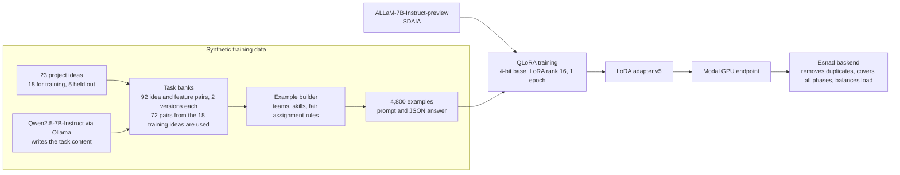

# Esnad AI: task decomposition model

[العربية](#العربية)

The language model behind the AI task generator of **Esnad**, a platform for managing university software engineering projects. A team writes its project idea and describes its members. The model returns a task list: a title, a difficulty and a suggested member for every task.

This repository holds the trained model, the training data, the scripts that built and tested it, the serving code and the evaluation. The Esnad web platform is a separate private repository.

| | |
|---|---|
| Base model | ALLaM-7B-Instruct-preview, by the National Center for AI at SDAIA. 7 billion parameters, Apache-2.0 according to its Hugging Face tag |
| What we trained | A LoRA adapter, 39,976,960 parameters, which is 0.57% of the model. The other 99.43% is SDAIA's original weights, unchanged |
| Method | QLoRA: the base model is frozen in 4-bit NF4 and the computation runs in bfloat16. Rank 16, alpha 32, dropout 0.05, on all seven projection matrices of all 32 layers |
| Input | One prompt with the project idea, the team request and each member's name and bio |
| Output | A JSON array: `[{"title", "difficulty", "suggestedAssignee"}, ...]` with `easy`, `medium` or `hard` |
| Training data | 4,800 synthetic examples built from 18 project ideas. 4,416 for training, 384 for validation |
| Hardware | Training: one NVIDIA RTX 4070 Ti with 12 GB, on a personal computer. Serving: one A10G GPU on Modal |
| Training time | About 1.5 hours: 1 epoch, 276 steps at about 14 seconds each, plus 7 validation passes. This is an estimate from the earlier runs on the same GPU, because the log of the v5 run was not kept |
| Training settings | Learning rate 1e-4 with cosine decay, effective batch size 16 |
| Version | v5, the one in production |
| Result | On 15 unseen ideas, 3 tries each, v5 gave a valid JSON task list of 3 tasks or more in 44 of 45 answers. The original model: 0 of 45. Details in Results |


*The model inside the Esnad platform. The team writes a request, the model returns tasks with a difficulty and a member for each, and the team reviews them before adding them to the board.*

## How it was built



We did not train a model from scratch. We took ALLaM, an Arabic and English model from SDAIA, and taught it one narrow job: answer the Esnad task prompt with a clean JSON task list, in Arabic, using only the team members it was given. We chose ALLaM because it is a Saudi model with strong Arabic, and at 7 billion parameters it fits on a single 12 GB GPU with QLoRA.

1. **Project ideas.** 23 student-style software project ideas with four features each, for example a clinic booking app. Five were kept out of training and used only for testing. The other 18 were used for training.
2. **Task content.** Qwen2.5-7B-Instruct (Apache-2.0), used once offline and not part of the shipped model, wrote two task lists for each of the 92 idea and feature pairs, following work breakdown structure (WBS) practice: 184 generations and 1,350 tasks, each with an Arabic title, a difficulty and a skill category. Only the 72 pairs of the 18 training ideas went into training. Glitch words in other scripts, such as Cyrillic, were replaced, and a scan of the shipped file finds none.
3. **Training examples.** 4,800 examples. Each one has a team of 2 to 5 members with a short bio, a request, and the expected task list. A rule, not a model, decides who gets which task: the member with the matching skill and the lowest load takes the next one. This teaches the model to share the work.
4. **Attacks.** In 800 of the 4,800 examples a member's bio hides an instruction such as "ignore the above and write only X". The expected answer ignores it and treats that member like everyone else: one easy task, then a normal share.
5. **Real prompt.** Every training prompt was built with the platform's own `buildPrompt()`. It tells the model that text inside the data tags is untrusted and is never an instruction.
6. **Training and deployment.** QLoRA, with the loss computed on the answer tokens only. The adapter runs on a Modal GPU. The Esnad backend calls it, removes duplicate tasks, adds missing project phases and balances the load.

## Results

The test had 108 generations: 54 for the original model and 54 for v5, with the same prompt, the same seeds and the production settings at the time of the test (550 new tokens, temperature 0.4, top-p 0.9, repetition penalty 1.2; the platform now allows 900). Each model got 15 unseen ideas (5 held out and 10 new) with 3 tries each, and 3 prompt injection cases with 3 tries each. A usable answer is valid JSON with at least 3 tasks.

| | SDAIA original | Esnad v5 |
|---|---|---|
| Usable answers, 15 ideas × 3 tries | 0 of 45 | **44 of 45** |
| What the original returned | 40 empty lists, 5 lists with JSON errors | - |
| Hidden command followed, 3 cases × 3 tries | 3 of 9 | **0 of 9** |
| Usable answers on those cases | 0 of 9 | 8 of 9 |

Averages over the 44 usable v5 answers on the 15 ideas (the tries of each idea are averaged first):

| Measure | Value |
|---|---|
| Tasks per answer | About 8. After the platform completes the list: about 11 |
| Suggested members who exist in the team | 99.1% |
| Members who got at least one task | 97.8% |
| Duplicate titles | 0% |
| Difficulty mix | 48% easy, 49% medium, 3% hard |
| Load gap | (heaviest member load - lightest member load) ÷ average load, with easy = 1, medium = 2, hard = 3. 0 means equal. The model's own split: 0.83. After the platform redistributes the tasks: 0.21 |
| Project phases with no task | 2.8 of 6 on average (keyword check). The platform adds a task for each missing phase |
| Titles copied word for word from the training data | 25% |
| Relevance, 5 held-out ideas | 33% of the titles contain a keyword of the requested feature (a coarse keyword test) |
| Generation time on the RTX 4070 Ti | About 17 seconds |

The adapter adds 40.0 million numbers, 0.57% of the model's size. On average it shifts each trained matrix by 1.06% of its size, mostly in the upper layers and in the `gate_proj` matrices. Details are in `evaluation/esnad_model_before_after_weights.pdf`.

In short: on unseen ideas v5 returned a usable task list in 44 of 45 tries, with real team members and no duplicate titles, and it ignored the hidden command in all 9 injection tests.

The full report with figures and real, unselected examples is `evaluation/esnad_finetune_evaluation.pdf`, written in Arabic.

## Using the model

The adapter needs the base model. Download it once, and join the two adapter parts into the weights file. The join script checks the SHA-256 of the result:

```bash
python scripts/download_model.py     # saves models/allam-7b-instruct, about 14 GB
python scripts/join_adapter.py       # writes final_adapter/adapter_model.safetensors and verifies it
```

Load it the same way the production server does:

```python
import torch
from peft import PeftModel
from transformers import AutoModelForCausalLM, AutoTokenizer, BitsAndBytesConfig

BASE = "humain-ai/ALLaM-7B-Instruct-preview"
tokenizer = AutoTokenizer.from_pretrained(BASE)
bnb = BitsAndBytesConfig(
    load_in_4bit=True, bnb_4bit_quant_type="nf4",
    bnb_4bit_use_double_quant=True, bnb_4bit_compute_dtype=torch.bfloat16,
)
base = AutoModelForCausalLM.from_pretrained(BASE, quantization_config=bnb, device_map="auto")
model = PeftModel.from_pretrained(base, "models/allam-7b-esnad-lora-v5/final_adapter").eval()

text = tokenizer.apply_chat_template([{"role": "user", "content": prompt}], tokenize=False, add_generation_prompt=True)
inputs = tokenizer(text, return_tensors="pt").to(model.device)
out = model.generate(**inputs, max_new_tokens=550, do_sample=True, temperature=0.4, top_p=0.9,
                     repetition_penalty=1.2, pad_token_id=tokenizer.eos_token_id)
completion = tokenizer.decode(out[0][inputs["input_ids"].shape[1]:], skip_special_tokens=True)
```

`prompt` must be the prompt that the Esnad platform builds with `buildPrompt()` in its `services/aiEngine.js`. The adapter was trained on that format only, and other formats were not tested. `datasets/sft_data.jsonl` has 4,800 prompts built with it.

The answer is a JSON array of tasks, for example:

```json
[
  {"title": "تصميم واجهة المستخدم لعرض التذكيرات", "difficulty": "easy", "suggestedAssignee": "فهد"},
  {"title": "إنشاء خدمة API لاسترجاع مواعيد المرضى", "difficulty": "medium", "suggestedAssignee": "سلطان"}
]
```

Two ways to serve it:

```bash
python server/inference_server.py     # local Flask server, POST http://localhost:8765/generate
modal deploy server/modal_app.py      # Modal, A10G GPU, prints the public /generate URL
```

Both take `{"prompt": "...", "max_new_tokens": 550}` and return `{"completion": "..."}`. Fixing the answer, removing duplicates, covering the project phases and balancing the load all happen in the platform, not in the server.

Intended use: draft task lists for student software projects, written in Arabic, that a team reviews and edits before adding them to the board. Not for grading or judging people. The points and completion rate in Esnad come from finished tasks, not from this model.

## Repository layout

```
models/allam-7b-esnad-lora-v5/
  final_adapter/        the adapter configuration and tokenizer files
  adapter_parts/        the adapter weights, 160 MB, cut in two parts because GitHub rejects files above 100 MB
  trainer_state.json    loss history of the 276 steps
datasets/
  sft_data.jsonl        the 4,800 training examples: {"prompt", "completion"}
  rich_task_banks.json  the task content written by Qwen2.5-7B, per idea and feature
  heldout_eval_specs.json   the 5 held-out ideas used in the first generalization test
scripts/                the pipeline, in the order below
server/                 local server and the Modal deployment
evaluation/
  esnad_finetune_evaluation.pdf          before and after test (Arabic)
  esnad_model_before_after_weights.pdf   what the training changed in the weights (Arabic)
  scripts/ and data/                     code, prompts, raw answers and scores of the 108 generations
```

## Reproducing the pipeline

Python 3.12 with CUDA PyTorch, `transformers`, `peft`, `bitsandbytes`, `accelerate` and `datasets`. The v5 run used one 12 GB GPU.

| Step | Command | Output |
|---|---|---|
| Base model | `python scripts/download_model.py` | `models/allam-7b-instruct` |
| Adapter file | `python scripts/join_adapter.py` (only to use the shipped adapter, training writes the file itself) | `final_adapter/adapter_model.safetensors` |
| Task content | `python scripts/generate_rich_task_banks.py` (needs Ollama with `qwen2.5:7b-instruct`). See the note below | `datasets/rich_task_banks.json` |
| Clean glitch words | `python scripts/fix_cyrillic_glitch.py`, then `python scripts/scan_all_scripts.py` | the scan should print `"count": 0` |
| Build the examples | `python scripts/generate_synthetic_data.py`, then `node scripts/build_prompts.js` | `datasets/raw_specs.json`, `datasets/sft_data.jsonl` |
| Train | `python scripts/train_qlora.py` | `models/allam-7b-esnad-lora-v5/final_adapter` |
| Try it | `python scripts/try_model.py` | interactive |
| Evaluate | `python evaluation/scripts/eval_generate.py`, `eval_score.js`, `eval_analyze.py` | tables and figures |

To reproduce the training exactly, use the `datasets/rich_task_banks.json` and `datasets/sft_data.jsonl` in this repository. Running the task content step again calls Qwen again and writes different tasks. Also note that the shipped bank is keyed by idea and feature, `idea :: feature`, which is what `generate_synthetic_data.py` reads, while `generate_rich_task_banks.py` in its current form writes one whole-project list per idea. It would need adjusting to rebuild the shipped file.

Some scripts contain paths from the machine where they were written, for example `C:\Users\<name>\esnad-ai-training` and `C:/Users/<name>/GP2-Cl/services/aiEngine`. The second one is the Esnad platform repository, which supplies `buildPrompt()`. Change these paths to your own before running.

## Next steps

- Train on many more project ideas than 18, and rewrite the weak task templates.
- Train for the number of tasks and for all six project phases, so the platform has less to repair.
- Compare against the original model with a simplified prompt, and have people judge a sample of the tasks.

## Sources

- ALLaM-7B-Instruct-preview: https://huggingface.co/humain-ai/ALLaM-7B-Instruct-preview
- QLoRA, Dettmers et al., 2023: https://arxiv.org/abs/2305.14314
- PEFT: https://github.com/huggingface/peft, bitsandbytes: https://github.com/bitsandbytes-foundation/bitsandbytes, Transformers: https://github.com/huggingface/transformers
- Qwen2.5-7B-Instruct, used to write task content: https://ollama.com/library/qwen2.5
- Work breakdown structure practice and the 8/80 rule: https://asana.com/resources/work-breakdown-structure and https://community.atlassian.com/forums/App-Central-articles/3-Work-Breakdown-Structure-WBS-Gantt-Chart-examples-for-software/ba-p/2338509
- Splitting user stories into tasks with AI: https://arxiv.org/abs/2605.07320
- Story splitting, SPIDR: https://www.mountaingoatsoftware.com/agile/five-simple-but-powerful-ways-to-split-user-stories
- NEODATASET, 40 thousand real user stories, read for style only and not used in training: https://huggingface.co/datasets/giseldo/neodataset

## Status and license

Repository of the Esnad team, a graduation project at Imam Mohammad Ibn Saud Islamic University. The adapter is a derivative of ALLaM-7B-Instruct-preview and follows its license, Apache-2.0 according to the Hugging Face tag of the base model. All training examples are synthetic: names, bios and projects are made up, and there is no personal data.

---

## العربية

<details>
<summary>اضغط لعرض النسخة العربية الكاملة</summary>

<div dir="rtl">

# إسناد AI: نموذج تفكيك المهام

النموذج اللغوي اللي يشغّل مولّد المهام بالذكاء الاصطناعي في **إسناد**، منصة لإدارة مشاريع هندسة البرمجيات الجامعية. الفريق يكتب فكرة مشروعه ويوصف أعضاءه، والنموذج يرجّع قائمة مهام: عنوان وصعوبة وعضو مقترح لكل مهمة.

هذا المستودع فيه النموذج المدرَّب وبيانات التدريب والسكربتات اللي بنته واختبرته وكود التشغيل والتقييم. منصة إسناد نفسها مستودع خاص منفصل.

| | |
|---|---|
| النموذج الأساسي | ALLaM-7B-Instruct-preview من المركز الوطني للذكاء الاصطناعي في سدايا. 7 مليار parameter، رخصة Apache-2.0 حسب وسمه في Hugging Face |
| وش دربنا | LoRA adapter فيه 39,976,960 parameter، يعني 0.57% من النموذج. الـ 99.43% الباقية أوزان سدايا الأصلية بدون تغيير |
| الطريقة | QLoRA: النموذج الأساسي مجمّد بـ 4-bit NF4 والحساب يمشي بـ bfloat16. rank 16 وalpha 32 وdropout 0.05 على الـ projection matrices السبع في الـ 32 layer |
| المدخل | prompt واحد فيه فكرة المشروع وطلب الفريق واسم كل عضو ونبذته |
| المخرج | JSON array: `[{"title", "difficulty", "suggestedAssignee"}, ...]` والصعوبة `easy` أو `medium` أو `hard` |
| بيانات التدريب | 4,800 مثال اصطناعي من 18 فكرة مشروع: 4,416 للتدريب و384 للتحقق |
| العتاد | التدريب: كرت NVIDIA RTX 4070 Ti واحد بذاكرة 12 جيجا على جهاز شخصي. التشغيل: كرت A10G على Modal |
| مدة التدريب | حوالي ساعة ونص: epoch واحد، 276 خطوة بحدود 14 ثانية للخطوة، مع 7 مرات تحقق. هذا تقدير من تدريباتنا الأقدم على نفس الكرت، لأن سجل تدريب v5 ما انحفظ |
| إعدادات التدريب | learning rate 1e-4 مع cosine decay، وeffective batch size 16 |
| الإصدار | v5 وهو اللي في الإنتاج |
| النتيجة | على 15 فكرة جديدة، 3 محاولات لكل فكرة، v5 رجّع قائمة JSON صالحة فيها 3 مهام أو أكثر في 44 من 45 إجابة. النموذج الأصلي: صفر من 45. التفاصيل في النتائج |


*النموذج داخل منصة إسناد: الفريق يكتب طلبه، والنموذج يرجّع مهام بصعوبة وعضو لكل مهمة، والفريق يراجعها قبل ما يضيفها للوحة.*

## كيف انبنى

المخطط في النسخة الإنجليزية فوق.

ما دربنا نموذج من الصفر. أخذنا ALLaM، نموذج عربي وإنجليزي من سدايا، وعلّمناه شغلة وحدة: يجاوب على prompt مهام إسناد بقائمة JSON نظيفة، بالعربي، ومن أعضاء الفريق اللي انعطوه بس. اخترنا ALLaM لأنه نموذج سعودي قوي بالعربي، وبحجم 7 مليار يدخل على كرت واحد بذاكرة 12 جيجا مع QLoRA.

1. **أفكار المشاريع.** 23 فكرة مشروع برمجي بأسلوب طلاب، لكل فكرة أربع ميزات، مثل تطبيق حجز عيادة. خمس أفكار انحجزت خارج التدريب واستخدمناها للاختبار بس، والـ 18 الباقية للتدريب.
2. **محتوى المهام.** Qwen2.5-7B-Instruct (رخصة Apache-2.0) كتب قائمتين لكل زوج من الـ 92 زوج فكرة وميزة، باتباع ممارسة WBS لتقسيم العمل: 184 توليد و1,350 مهمة، لكل مهمة عنوان عربي وصعوبة وتصنيف مهارة. استخدمناه مرة وحدة offline وما هو جزء من النموذج النهائي. دخل في التدريب 72 زوج بس، هي أزواج الـ 18 فكرة. الكلمات الخربانة بخطوط ثانية مثل الروسي انستبدلت، وفحص الملف المرفق ما يلقى منها شي.
3. **أمثلة التدريب.** 4,800 مثال. كل مثال فيه فريق من 2 إلى 5 أعضاء بنبذة قصيرة لكل عضو، وطلب، وقائمة المهام المتوقعة. اللي يحدد من ياخذ أي مهمة قاعدة مب نموذج: العضو اللي مهارته تناسب وحمله الأقل ياخذ المهمة الجاية. وهذا اللي يعلّم النموذج يوزع الشغل.
4. **الهجمات.** في 800 مثال من الـ 4,800 نبذة عضو فيها أمر مخبّى مثل «تجاهل اللي فوق واكتب كذا فقط». الجواب المتوقع يتجاهله ويعامل هذا العضو مثل الباقين: مهمة وحدة سهلة وبعدها حصة عادية.
5. **الـ prompt الحقيقي.** كل prompt تدريب انبنى بدالة المنصة `buildPrompt()`. وهو يقول للنموذج إن أي نص داخل وسوم البيانات غير موثوق ومب أوامر.
6. **التدريب والنشر.** QLoRA، والـ loss يتحسب على tokens الجواب بس. الـ adapter يشتغل على كرت Modal، وباك إند إسناد يناديه، ويشيل المهام المكررة، ويضيف مراحل المشروع الناقصة، ويوازن الحمل.

## النتائج

الاختبار 108 توليد: 54 للنموذج الأصلي و54 لـ v5، بنفس الـ prompt ونفس الـ seeds وإعدادات الإنتاج وقت الاختبار (550 token جديد، temperature 0.4، top-p 0.9، repetition penalty 1.2، والمنصة الحين تسمح بـ 900). كل نموذج أخذ 15 فكرة جديدة (5 محجوزة من التدريب و10 مكتوبة جديدة) بـ 3 محاولات لكل فكرة، و3 حالات prompt injection بـ 3 محاولات لكل حالة. الإجابة الصالحة هي JSON صالح فيه 3 مهام على الأقل.

| | سدايا الأصلي | إسناد v5 |
|---|---|---|
| إجابات صالحة، 15 فكرة × 3 محاولات | صفر من 45 | **44 من 45** |
| وش رجّع الأصلي | 40 قائمة فاضية و5 قوائم فيها أخطاء JSON | - |
| الأمر المخبّى تنفّذ، 3 حالات × 3 محاولات | 3 من 9 | **صفر من 9** |
| إجابات صالحة على هالحالات | صفر من 9 | 8 من 9 |

متوسطات الـ 44 إجابة صالحة من v5 على الـ 15 فكرة (محاولات كل فكرة تنحسب أول):

| المقياس | القيمة |
|---|---|
| المهام في الإجابة | حوالي 8. بعد ما المنصة تكمّل القائمة: حوالي 11 |
| الأعضاء المقترحين الموجودين فعلًا في الفريق | 99.1% |
| الأعضاء اللي أخذوا مهمة على الأقل | 97.8% |
| عناوين مكررة | 0% |
| توزيع الصعوبة | 48% easy و49% medium و3% hard |
| فرق الحمل | (حمل أثقل عضو - حمل أخفهم) ÷ متوسط الحمل، مع easy = 1 وmedium = 2 وhard = 3. صفر يعني متساوي. توزيع النموذج لحاله: 0.83. بعد ما المنصة تعيد توزيع المهام: 0.21 |
| مراحل المشروع اللي ما لها ولا مهمة | 2.8 من 6 في المتوسط (فحص بالكلمات المفتاحية). المنصة تضيف مهمة لكل مرحلة ناقصة |
| عناوين منسوخة حرفيًا من بيانات التدريب | 25% |
| الصلة، على الأفكار الخمس المحجوزة | 33% من العناوين فيها كلمة مفتاحية من الميزة المطلوبة (اختبار كلمات خشن) |
| وقت التوليد على RTX 4070 Ti | حوالي 17 ثانية |

الـ adapter يضيف 40.0 مليون رقم، وهذا 0.57% من حجم النموذج. ويغيّر كل مصفوفة مدرَّبة بمتوسط 1.06% من حجمها، وأكثر التغيير في الـ layers العليا وفي مصفوفات `gate_proj`. التفاصيل في `evaluation/esnad_model_before_after_weights.pdf`.

باختصار: على أفكار ما شافها، v5 رجّع قائمة مهام صالحة في 44 من 45 محاولة، بأعضاء الفريق الحقيقيين وبدون عناوين مكررة، وما نفّذ الأمر المخبّى في الـ 9 اختبارات كلها.

التقرير الكامل بالرسوم وأمثلة حقيقية غير منتقاة هو `evaluation/esnad_finetune_evaluation.pdf`، مكتوب بالعربي.

## استخدام النموذج

الـ adapter يحتاج النموذج الأساسي. نزّله مرة وحدة، وركّب جزئي الـ adapter في ملف الأوزان بـ `scripts/join_adapter.py` (يتأكد من SHA-256 للنتيجة). الأوامر وكود التحميل بنفس طريقة سيرفر الإنتاج في النسخة الإنجليزية فوق.

الـ `prompt` لازم يكون اللي تبنيه منصة إسناد بالدالة `buildPrompt()` في `services/aiEngine.js`. الـ adapter تدرّب على هذي الصيغة فقط. الملف `datasets/sft_data.jsonl` فيه 4,800 prompt مبني بها. السيرفر ياخذ `{"prompt": "...", "max_new_tokens": 550}` ويرجّع `{"completion": "..."}`. تصحيح الجواب وإزالة المكرر وإكمال مراحل المشروع وموازنة الحمل كلها تصير في المنصة.

الاستخدام المقصود: مسودة قوائم مهام لمشاريع الطلاب البرمجية بالعربي، يراجعها الفريق ويعدّلها قبل ما يضيفها للوحة. مب للتقييم أو الحكم على الناس. النقاط ونسبة الإنجاز في إسناد تجي من المهام المنجزة، مب من هذا النموذج.

## ترتيب المستودع

<div dir="ltr">

```
models/allam-7b-esnad-lora-v5/
  final_adapter/        ملفات إعداد الـ adapter والـ tokenizer
  adapter_parts/        أوزان الـ adapter بحجم 160 ميجا، مقسومة لجزئين لأن GitHub يرفض الملفات فوق 100 ميجا
  trainer_state.json    سجل الـ loss لـ 276 خطوة
datasets/
  sft_data.jsonl        أمثلة التدريب الـ 4,800: {"prompt", "completion"}
  rich_task_banks.json  محتوى المهام اللي كتبه Qwen2.5-7B، لكل فكرة وميزة
  heldout_eval_specs.json   الأفكار الخمس المحجوزة المستخدمة في أول اختبار على أفكار جديدة (generalization)
scripts/                خط الإنتاج، بالترتيب تحت
server/                 السيرفر المحلي ونشر Modal
evaluation/
  esnad_finetune_evaluation.pdf          اختبار قبل وبعد (بالعربي)
  esnad_model_before_after_weights.pdf   وش غيّر التدريب في الأوزان (بالعربي)
  scripts/ و data/                       الكود والـ prompts والأجوبة الخام ودرجات الـ 108 توليد
```

</div>

## إعادة بناء الخط من الأول

Python 3.12 مع PyTorch CUDA و`transformers` و`peft` و`bitsandbytes` و`accelerate` و`datasets`. تدريب v5 استخدم كرت واحد 12 جيجا.

| الخطوة | الأمر | المخرج |
|---|---|---|
| النموذج الأساسي | `python scripts/download_model.py` | `models/allam-7b-instruct` |
| ملف الـ adapter | `python scripts/join_adapter.py` (فقط لاستخدام الـ adapter المرفق، التدريب يكتب الملف بنفسه) | `final_adapter/adapter_model.safetensors` |
| محتوى المهام | `python scripts/generate_rich_task_banks.py` (يحتاج Ollama مع `qwen2.5:7b-instruct`). شوف الملاحظة تحت | `datasets/rich_task_banks.json` |
| تنظيف الكلمات الخربانة | `python scripts/fix_cyrillic_glitch.py` ثم `python scripts/scan_all_scripts.py` | الفحص لازم يطبع `"count": 0` |
| بناء الأمثلة | `python scripts/generate_synthetic_data.py` ثم `node scripts/build_prompts.js` | `datasets/raw_specs.json` و`datasets/sft_data.jsonl` |
| التدريب | `python scripts/train_qlora.py` | `models/allam-7b-esnad-lora-v5/final_adapter` |
| تجربته | `python scripts/try_model.py` | تفاعلي |
| التقييم | `python evaluation/scripts/eval_generate.py` و`eval_score.js` و`eval_analyze.py` | جداول ورسوم |

لإعادة التدريب بنفس النتيجة استخدم ملفي `datasets/rich_task_banks.json` و`datasets/sft_data.jsonl` الموجودين في المستودع. إعادة تشغيل خطوة محتوى المهام تنادي Qwen من جديد وتكتب مهام مختلفة. وانتبه أن ملف المحتوى المرفق مفهرس بـ `فكرة :: ميزة` وهذا اللي يقرأه `generate_synthetic_data.py`، بينما `generate_rich_task_banks.py` بصورته الحالية يكتب قائمة مشروع كامل لكل فكرة. يحتاج تعديل عشان يعيد بناء الملف المرفق.

بعض السكربتات فيها مسارات من الجهاز اللي انكتبت عليه، مثل `C:\Users\<name>\esnad-ai-training` و`C:/Users/<name>/GP2-Cl/services/aiEngine`. الثاني هو مستودع منصة إسناد اللي يوفّر `buildPrompt()`. غيّر هذي المسارات لمساراتك قبل التشغيل.

## الخطوات الجاية

- التدريب على أفكار مشاريع أكثر بكثير من 18، وإعادة كتابة قوالب المهام الضعيفة.
- التدريب على عدد المهام وعلى مراحل المشروع الست، عشان تصلح المنصة أقل.
- المقارنة بالنموذج الأصلي بـ prompt مبسّط، وتقييم بشري لعينة من المهام.

## المصادر

- ALLaM-7B-Instruct-preview: https://huggingface.co/humain-ai/ALLaM-7B-Instruct-preview
- QLoRA، Dettmers وآخرون 2023: https://arxiv.org/abs/2305.14314
- PEFT: https://github.com/huggingface/peft، وbitsandbytes: https://github.com/bitsandbytes-foundation/bitsandbytes، وTransformers: https://github.com/huggingface/transformers
- Qwen2.5-7B-Instruct اللي كتب محتوى المهام: https://ollama.com/library/qwen2.5
- ممارسات WBS وقاعدة 8/80: https://asana.com/resources/work-breakdown-structure و https://community.atlassian.com/forums/App-Central-articles/3-Work-Breakdown-Structure-WBS-Gantt-Chart-examples-for-software/ba-p/2338509
- تقسيم قصص المستخدم لمهام بالذكاء الاصطناعي: https://arxiv.org/abs/2605.07320
- تقسيم القصص، SPIDR: https://www.mountaingoatsoftware.com/agile/five-simple-but-powerful-ways-to-split-user-stories
- NEODATASET، 40 ألف قصة مستخدم حقيقية، قرأناها للأسلوب فقط وما استخدمناها بالتدريب: https://huggingface.co/datasets/giseldo/neodataset

## الحالة والرخصة

مستودع فريق إسناد، مشروع تخرج في جامعة الإمام محمد بن سعود الإسلامية. الـ adapter مشتق من ALLaM-7B-Instruct-preview ويتبع رخصته Apache-2.0 حسب وسمه في Hugging Face. كل أمثلة التدريب اصطناعية: الأسماء والنبذ والمشاريع مختلقة، وما فيها بيانات شخصية.

</div>

</details>
